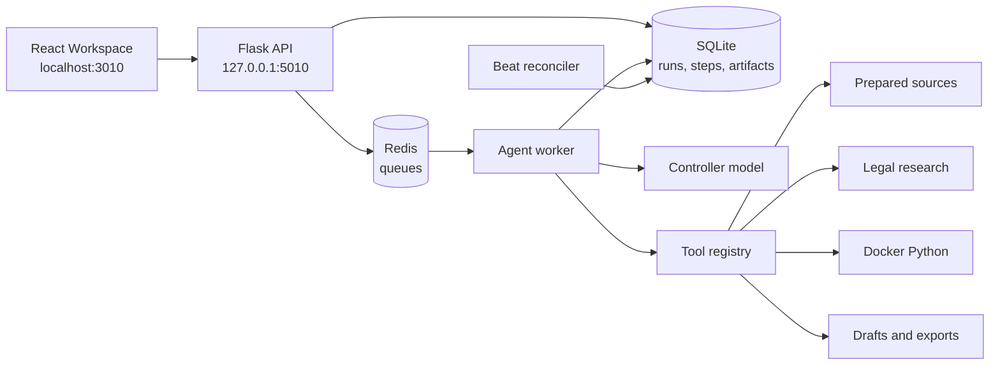
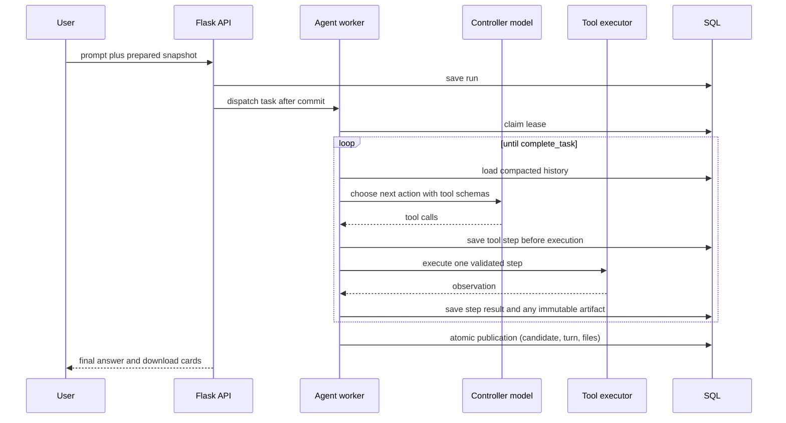

# zyx-agentic-llms

**Workspace** is a document-centric AI agent for professional knowledge work. It
combines conversation, source retrieval, research, calculation, drafting and
verification in one chat-first application, with legal expertise enabled by
default. The agent chooses its own sequence of tools; the application owns
authorization, durable state, context limits and publication.

This repository is a self-contained local development environment. It runs its
own Flask API, React frontend, Redis, Celery workers, SQLite database and Docker
execution runtime. Production deployment and a second model provider are separate
work.

## What it does

| Capability | Behavior |
| --- | --- |
| Conversation and projects | Projects hold reusable documents; conversations hold prompt attachments, runs and Output. |
| Source preparation | PDFs, DOCX, text, Markdown, CSV and XLSX are prepared into an immutable per-request snapshot with page/sheet locations. |
| Retrieval | Search and read exact original ranges, not a lossy summary. Gaps and extraction limits are reported. |
| Research | Web search for current information; optional legal research with CourtListener lookup, authority snapshots and read passages. |
| Analysis | Saved analysis over selected materials, with explicit per-operation purposes. |
| Computation | Isolated Docker Python for spreadsheet inspection, reconciliation, formula recalculation and generated CSV/XLSX. |
| Drafting | Markdown candidates from materials or uploaded originals; focused replacements or full rewrites; confirmed versions and rollback. |
| Verification | A saved report about a specific draft target, with unresolved findings disclosed. |
| Delivery | Authenticated download cards for explicitly selected generated files; Markdown, HTML, DOCX and PDF export. |
| Local identity | First-visit local account, hashed passwords, signed HttpOnly session and CSRF protection. |

Legal tools and instructions are removed when `WORKSPACE_LEGAL_ENABLED=0`; general
source analysis, web research, drafting and computation remain.

The shell is chat-first: a collapsible project/conversation sidebar, a composer
with reusable **Project documents** and conversation-scoped **prompt
attachments**, and a right-side **Output** panel for the editable working document
and downloads. See [documents and attachments](docs/project-documents-and-attachments.md)
and [the frontend](docs/frontend-redesign.md).

## Agent harness

### System shape



The model chooses; the application executes, validates and records. Redis carries
jobs; SQL is the authoritative record. A saved run can be inspected, retried or
audited without reconstructing hidden state.

### One request



Key properties:

- **No fixed pipeline.** The controller may read, search, calculate, draft,
  verify, ask the user or finish in any order. There is no mandatory
  retrieve → draft → verify sequence.
- **One saved decision at a time.** Each model choice is persisted before the
  tool runs; each worker invocation performs one step.
- **Scope is rechecked, not trusted.** A tool can only use IDs from the request's
  snapshot and this run's artifacts. Unknown, out-of-scope and wrong-kind IDs
  become error observations.
- **Context is engineered.** Older completed work is compacted into generated
  notes at 80% of the model's usable input budget, preserving exact IDs,
  clarifications, purposes and unresolved findings. The full history remains in
  SQL.
- **Evidence is bounded.** Selected materials are de-duplicated across cumulative
  research snapshots. An oversized material request returns a recoverable error
  with per-material token totals so the controller can retry with less; an
  irreducible request stops the run.
- **Publication is atomic.** Draft candidate, conversation turn, confirmed
  version, output files and run result commit together after lease, version,
  snapshot, permission and citation-review checks.

### Tools

| Group | Tools |
| --- | --- |
| Context | `list_documents`, `search_sources`, `read_sources`, `web_search` |
| Legal research | `lookup_authorities`, `search_legal_sources`, `read_authority` |
| Analysis | `analyze_material`, `python_run` |
| Drafting | `create_draft`, `revise_draft`, `verify_draft`, `list_draft_versions`, `restore_draft` |
| Control | `request_user_input`, `complete_task` |

The full design — state machine, prompt assembly, compaction algorithm, failure
taxonomy, publication invariants and extension points — is in
[agent harness design](docs/agent-harness.md).

## Run it locally

On a prepared checkout, start with:

```sh
.venv/bin/python scripts/dev.py start
.venv/bin/python scripts/dev.py status
.venv/bin/python scripts/dev.py stop
```

Open **http://localhost:3010** and create the local account on first visit.
`start` applies project-owned migrations and launches Redis, Flask, the agent
worker, document worker, reconciler and frontend. Logs and PID records are under
`instance/dev/`. Occupied ports fail startup rather than attaching to another
service.

A fresh checkout needs Python 3.11, Node 22, `redis-server`, `antiword`, optional
Tesseract, and Docker for Python/PDF tools. The complete macOS setup, database,
Docker, verification and troubleshooting steps are in the
[runbook](docs/runbook.md).

## Configuration and storage

- `MODEL_PROVIDER=openai` selects the supported adapter. Model choices are
  role-based in `config/models.json`: preparation and utility work use
  `gpt-6-luna`, while controller, analysis, writer and verifier use
  `gpt-6.1-sol` at medium effort.
- `WORKSPACE_MODEL_<ROLE>` and `WORKSPACE_EFFORT_<ROLE>` are optional per-role
  overrides. New runs save one `model_settings` snapshot; retries retain it. There
  is no frontend model selector and no fast/deep mode. See
  [model settings](docs/model-settings.md).
- `WORKSPACE_LEGAL_ENABLED=0` removes legal tools and instructions.
- The database is SQLite at `instance/zyx-agentic-llms.db`. An override must be an
  absolute file inside this project's `instance/`.
- Redis is this project's process on `127.0.0.1:6390`; queues use the
  `zyx-agentic-llms.dev` namespace.
- Originals, Python runs and exports live under `instance/workspace/`. Web and
  worker processes share that durable storage.
- `.env`, `.private/`, `.venv/`, `instance/` and `artifacts/` are ignored by Git.
  Never commit credentials, private documents or browser sessions.

The application is independent of the original source project's checkout: own
Python environment, Node dependencies, database, Redis process, queues, signing
key, storage, tokenizer cache and logs. Host tools such as Node, the Redis
executable and Docker remain machine prerequisites. See
[local isolation](docs/local-isolation.md).

## Verification

Offline backend suite (mocked providers, temporary databases, external network
guard):

```sh
ZYX_E2E=1 .venv/bin/python -m pytest -q -p tests.offline_guard
```

Real isolated Redis/Celery and Docker replay, when explicitly enabled:

```sh
ZYX_E2E=1 ZYX_REPLAY_E2E=1 ZYX_PYTHON_LIVE=1 \
  .venv/bin/python -m pytest -q -p tests.offline_guard
```

Frontend, from `frontend/`:

```sh
CI=true npm test -- --watch=false --runInBand
npm run build
npm run test:e2e
```

Live paid-provider evaluations are separate and opt-in. Their suites, baselines
and comparison rules are in the [live suite registry](tests/live/README.md).
The mock-live workflow is documented in [tests/e2e/README.md](tests/e2e/README.md).

## Documentation

| Document | Contents |
| --- | --- |
| [Runbook](docs/runbook.md) | macOS install, SQLite, Docker, start/stop, tests, troubleshooting |
| [Dependency updates](docs/dependency-updates.md) | Quarterly update policy, compatibility groups, gate commands |
| [Agent harness](docs/agent-harness.md) | Decision loop, state, context, failure and publication design |
| [Architecture](docs/architecture.md) | Service topology, code map, request lifecycle |
| [General drafting](docs/general-drafting.md) | Material purposes, resolution, drafting and verification behavior |
| [Draft versions](docs/draft-versions.md) | Working candidate, confirmed versions, rollback |
| [Draft edits](docs/draft-edits.md) | Focused replacements, rewrites, all-or-nothing validation |
| [Completion validation](docs/completion-validation.md) | Citation-review coverage and completion schema |
| [Authority page evidence](docs/authority-page-evidence.md) | Page locations, pinpoints and conservative reporting |
| [Opinion selection](docs/opinion-selection.md) | Explicit versus null opinion selection |
| [File delivery](docs/file-delivery.md) | Selected generated files and authenticated downloads |
| [Documents and attachments](docs/project-documents-and-attachments.md) | Project documents versus prompt attachments |
| [Frontend](docs/frontend-redesign.md) | Shell, sidebar, panels and interaction behavior |
| [Local isolation](docs/local-isolation.md) | Independent services, accounts, storage and verification |
| [Live suites](tests/live/README.md) | Live packs, recorded baselines and recording rules |
| [Refactoring status](docs/refactoring-status.md) | Scope, deferred work and preservation checks |
| [Mock-live results](docs/workspace-replay-results.md) | Replay coverage and measured results |

## Scope and limits

This is a local development foundation, not a production deployment. Deliberately
deferred: a second provider, dynamic skills/MCP, additional domain packages,
multi-user administration, production secret management, monitoring, backups and
load testing. Live evaluation measures one run at a time and does not establish a
performance distribution or a service-level guarantee. Generated legal work is
not filing advice; unresolved authorities and facts remain for the responsible
professional to check.
