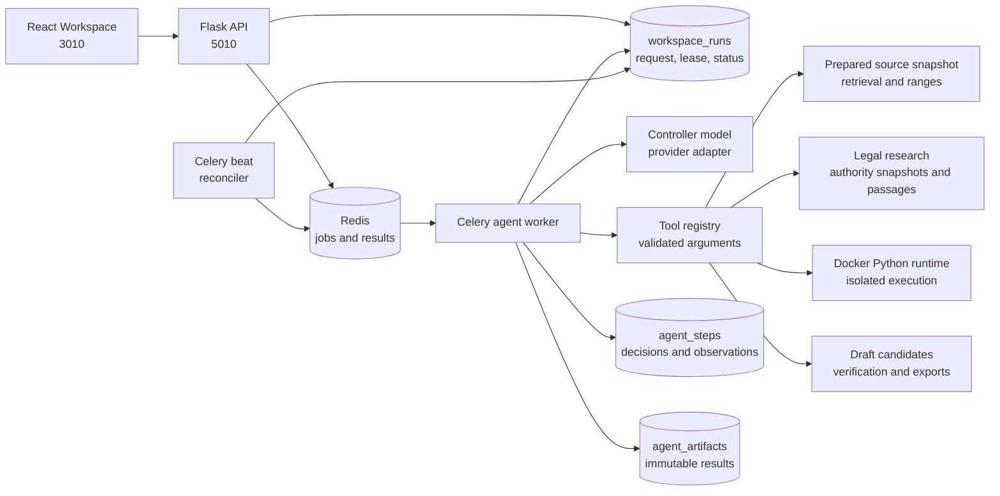
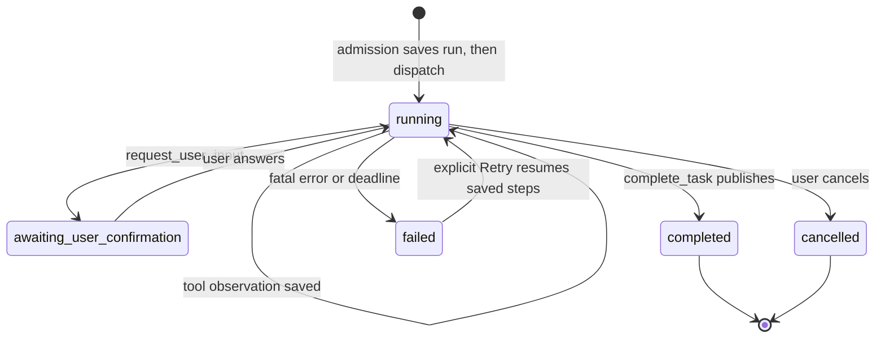
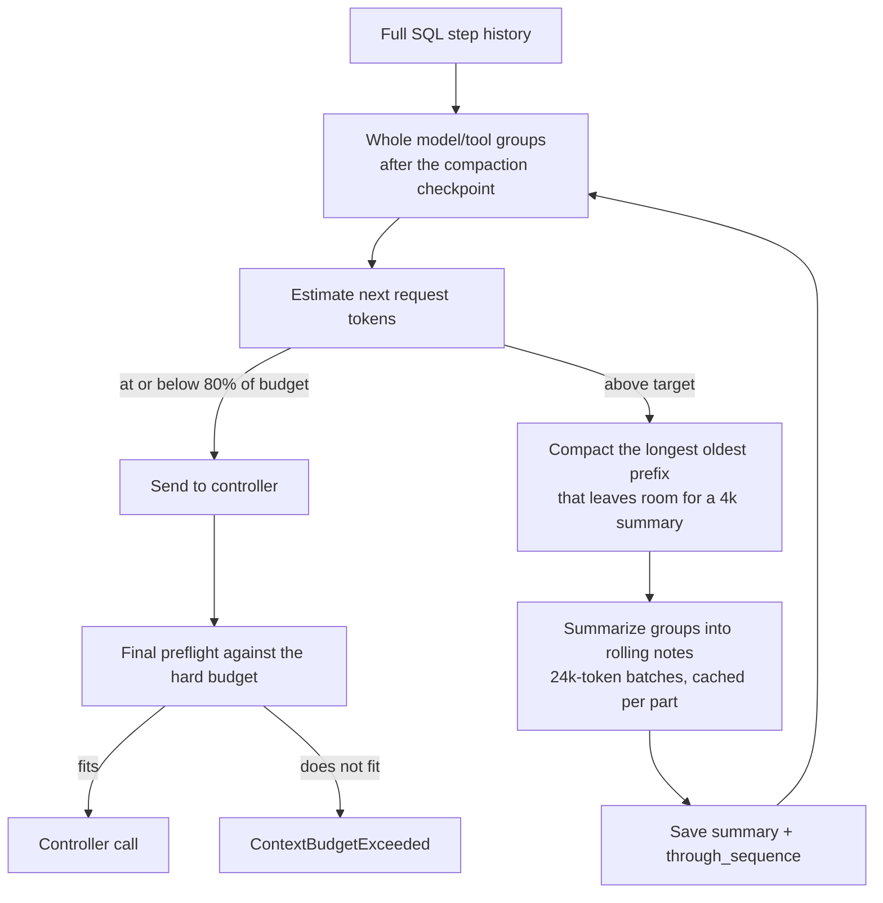

# Agent harness design

This document explains Workspace's agent loop as an AI-agent system: what the
model decides, what the application owns, how state and context are managed, and
where failures are recovered or stopped. For service topology and module
boundaries, see [architecture](architecture.md). For setup and operation, see the
[runbook](runbook.md).

## Design stance

The harness follows one rule: **the model proposes, the application disposes.**

- The controller model chooses one or more tool calls from a declared catalogue.
- Each choice is saved as an SQL step before any tool runs.
- A worker executes that saved choice, validates it against the request's
  authorized scope, and saves the observation, plus an immutable artifact when
  the tool produces one.
- The next controller call sees the observation and chooses again.
- Completion publishes through one atomic application transaction.

There is no planner graph, no fixed retrieve → analyze → draft → verify chain and
no Celery chain/chord orchestration. The sequence is whatever the controller
chooses, bounded by authorization, context, deadline and cancellation rules. The
application never infers a hidden pipeline from the request type.

Two consequences matter:

1. **Every decision is inspectable.** A finished run is a sequence of model
   decisions and tool observations, not an opaque answer.
2. **Every effect is re-checkable.** A tool call is data until the executor
   validates ownership, scope, version and lease.

## Components and durable records

| Record | Role |
| --- | --- |
| `WorkspaceRun` | One submitted request. Holds the accepted request and document snapshot (`data_json`), agent context and source hints (`payload_json`), terminal result (`result_json`), status/phase, lease token and expiry, dispatch state, deadline, base draft version and draft hash. |
| `AgentStep` | One ordered decision or observation. `kind=model` is `choose_next_action`; `kind=tool` is the chosen operation with its raw arguments, result, summary and state (`queued`, `running`, `waiting`, `ready`). |
| `AgentArtifact` | Immutable tool output: `source`, `authority_research`, `authority_source`, `analysis`, `draft`, `verification`, `python_execution`, `derived_file`, `web_search`. Referenced by ID; never edited in place. |
| Prepared source snapshot | Immutable per-request list of accepted file versions, scopes and preparation artifacts. Tool authorization is checked against it. |
| Canonical document state | The live working draft, confirmed versions and conversation turns, owned by the application rather than the model. |

Redis carries task delivery and transient results. SQL is the authoritative run
and document store: a Redis result that was never committed is not an
application record.

## Lifecycle

1. **Admission.** The API authorizes the conversation, captures the prepared
   source snapshot, resolves the saved model policy, writes `WorkspaceRun`, then
   publishes the task. The request is durable before any provider call.
2. **Claim.** A worker conditionally claims the run by writing a lease token and
   expiry. Only one worker may own the run at a time.
3. **Initialize.** The first claim builds the initial controller context:
   assignment, conversation context, document catalogue, current draft summary
   and saved legal-research catalogue.
4. **Decide.** The controller receives the compacted history and the tool
   schemas. Its chosen calls are saved as `queued` tool steps.
5. **Execute.** A later claim executes the first pending step. Arguments are
   schema-validated; scope, artifact ownership and snapshot membership are
   re-checked; the observation is saved with a `ready` step, plus an immutable
   artifact when the tool produces one.
6. **Repeat.** Steps 4–5 continue until the controller calls `complete_task`,
   asks the user, or the run is stopped.
7. **Publish.** Completion rechecks lease, cancellation, editor permission,
   draft version, source snapshot, citation-review coverage and selected files,
   then stages the draft, conversation turn, run result and artifact references
   in one commit.

Each `advance` call performs exactly one step. A model turn that returns three
tool calls creates three steps; each executes in its own worker invocation. That
keeps worker time bounded and makes retries and inspection straightforward.

## What the controller sees

The controller input is assembled in a fixed order:

1. System instructions: role, available tools, source-as-data rule, drafting and
   verification expectations, spreadsheet and file-delivery rules, legal
   research guidance.
2. The initial user context: assignment, conversation, document catalogue,
   current draft metadata, saved legal-research catalogue, current date.
3. A system message with the **authoritative current working-draft state**,
   which overrides history and summaries.
4. Pinned user clarifications, when any exist.
5. A generated working-notes block, when older history has been compacted.
6. Remaining saved step groups, oldest first: each model call, its arguments,
   and the matching tool result.

Tool schemas are generated per run. `complete_task` additionally receives the
current citation-review items and evidence IDs so the model can select real IDs
rather than guess. If an enum would exceed provider limits, the schema falls
back to execution-time validation and logs that explicitly.

## Tools

| Group | Tool | Output |
| --- | --- | --- |
| Context | `list_documents` | Authorized files, versions, scopes, extraction gaps, saved research and citation checklist |
| Context | `search_sources` | Passage ranges in prepared originals |
| Context | `read_sources` | Exact original ranges or saved artifacts, pageable by character offset |
| Context | `web_search` | Generated search summary plus observed links (not full page text) |
| Research | `lookup_authorities` | Citation discovery, CourtListener lookup, coverage and conflicts |
| Research | `search_legal_sources` | CourtListener or web search added to one research record |
| Research | `read_authority` | One opinion/web/PDF passage, its cache and continuation IDs |
| Analysis | `analyze_material` | Saved analysis, separate from original evidence |
| Analysis | `python_run` | Isolated Python execution, saved result or structured error |
| Drafting | `create_draft` | First Markdown candidate; editor unchanged |
| Drafting | `revise_draft` | New candidate from the working draft or an uploaded original |
| Drafting | `verify_draft` | Saved verification report about a recorded target |
| Drafting | `list_draft_versions` | Confirmed versions eligible for rollback |
| Drafting | `restore_draft` | New candidate copied from a confirmed version |
| Control | `request_user_input` | Pauses the run and resumes the same step with an answer |
| Control | `complete_task` | Publishes response, optional candidate and selected files |

Legal tools are removed from both the schema and the executor when
`WORKSPACE_LEGAL_ENABLED=0`.

### Authorization, not trust

The model can only name IDs it has seen, but naming an ID is not authorization.
Every operation rechecks:

- the run and conversation still own the artifact;
- the artifact kind matches the requested use;
- a document ID belongs to the request's prepared snapshot;
- a draft target is the current working draft or a valid uploaded original;
- a generated file belongs to a successful `python_run` in this run;
- the worker still holds the lease and the run is not cancelled or expired.

Unknown, out-of-scope and wrong-kind IDs return an error observation. The model
can correct the call; the application never silently remaps an ID.

## Context management

- Context limits are declared per model (for the current OpenAI models, a
  1,050,000-token window, minus a default 128,000-token output reserve and a
  2,048-token safety margin).
- Compaction targets 80% of the usable input budget, leaving room for the rolling
  notes and the final preflight.
- Only whole decision/observation groups are compacted. The full history stays in
  SQL; the summary is generated working notes, not evidence.
- Summaries preserve exact artifact/source IDs, the current candidate,
  clarifications, material purposes, verification-target pairs, unresolved
  findings and outstanding checks.
- Summarization itself is batched and checkpointed, so a long compaction can
  resume instead of restarting.
- The final assembled request is measured again before dispatch. The application
  never truncates instructions, clarifications or evidence silently.

### Material envelopes and duplicate research

Material-bearing tools (`analyze_material`, `create_draft`, `revise_draft`,
`verify_draft`) receive selected materials as envelopes with their saved
identity and the controller's purpose for that operation.

Authority research records are cumulative snapshots. If one operation selects a
snapshot plus its ancestors or siblings, the resolver groups them by lineage
root, keeps the most complete snapshot (reads, then sources, then authorities,
then recency), re-adds distinct read passages from the dropped branches, and
merges purposes. The requested `material_ids` stay unchanged in the saved
arguments; `resolved_material_ids` and `material_resolution` record what actually
reached the model and why. Separate lineages are never merged.

### Budget failures

A `ContextBudgetExceeded` carries the measured request tokens, the allowance and
whether supporting evidence is reducible.

| Situation | Outcome |
| --- | --- |
| Material tool request is too large because of selected evidence | Recoverable tool error with per-material and per-kind token totals; the controller can retry with fewer materials |
| Drafting request exceeds the budget even with no supporting evidence | Fatal; the exact draft, instructions and question cannot fit |
| Publication, editor check, discovery helper or other non-material budget failure | Fatal |
| Compaction or provider request still too large after compaction | Fatal, with explicit Retry |

Recoverable errors are marked `tool_recoverable` by the executor. The worker turns
only those into observations; every other budget error stops the run.

## Failure and recovery model

| Event | Behavior |
| --- | --- |
| Invalid tool arguments or unknown ID | Saved error observation; controller retries |
| Preparation or source-version failure | Fatal; no tool execution against a stale snapshot |
| Provider/controller failure | User-facing controller error; explicit Retry resumes saved steps |
| Compaction failure | Saved checkpoint retained; explicit Retry continues |
| Worker loss or task timeout | Errback marks the task failed; lease and deadline checks prevent late writes |
| Queue delivery lost after commit | Beat reconciler re-dispatches the saved task ID |
| Cancellation | Run status changes and the lease is invalidated; late workers cannot publish |
| Clarification | Question saved, lease released; answering resumes the same step |
| Stale draft during clarification | Rejected; the user must send a new request |
| Publication guard failure | No partial write; candidate, turn and result remain unpublished |
| Unchanged revision | No candidate is saved; the working draft is unchanged |

The hard request deadline is six hours by default. Each worker claim receives a
22-minute lease, and each step is claimed separately with a fresh lease. A claimed
task that loses its worker requires explicit Retry, because the application cannot
know whether the provider call completed.

## Publication invariants

`complete_task` is the only path that changes Output. Publication rechecks:

- the run is still active and the worker still holds the lease;
- the candidate belongs to this run, conversation and document;
- the draft version has not moved since admission;
- the prepared source snapshot is still valid;
- an explicit user prohibition on editor changes is enforced;
- citation-review outcomes cover every required item in scope;
- selected generated files belong to successful executions in this run;
- the response is non-empty and safe to render.

Draft candidate, conversation turn, confirmed version, output files and run result
commit together. A failure leaves the previous Output and turn intact.

## Provider boundary

The harness depends on a small protocol: `decide(...)` returns a provider
checkpoint plus tool calls, and `structured(...)` supports typed helper calls.
The current release implements only `MODEL_PROVIDER=openai`. Provider-specific
reasoning/continuation state is stored in the step result and replayed, but tool
semantics, authorization, compaction and publication stay application-owned.
Adding another provider means implementing the protocol and proving checkpoint,
structured-output, tool-schema and budget behavior against the same offline
suites and live benchmark; it does not mean rewriting the loop.

## Extension points

- **New tool.** Add a strict argument model, an executor branch with scope checks,
  a description, and regression tests for invalid IDs and wrong kinds.
- **New domain.** Add instructions, tools, sources and evaluation tasks as a
  package; keep the decision loop and publication rules shared.
- **New document operation.** Return a candidate through the existing draft
  engine; do not mutate Output directly.
- **New evidence source.** Save it as an immutable artifact with a stable ID and
  a location note, then let the controller select it by ID.

Deliberately absent: dynamic tool installation, MCP discovery, packaged skills,
a mandatory reviewer stage, a fixed task pipeline and multi-agent delegation
inside one run. These are product decisions, not missing plumbing.

## Observability

Every decision and observation is queryable in SQL. A run can be reconstructed
from `agent_steps` plus `agent_artifacts`; the live benchmark additionally records
metrics, tool errors, retries, outputs, confirmed versions and download checks.
See the [live suite registry](../tests/live/README.md) for the recorded baselines.

## Invariants to preserve

1. Save the request before dispatch.
2. One active run per conversation.
3. A worker writes only while it holds a valid lease.
4. Source snapshots and artifacts are immutable.
5. Tool arguments are validated against the current authorized scope.
6. Compaction never replaces evidence; it replaces repeated history with notes.
7. Publication is atomic and version-checked.
8. Cancellation fences late results.
9. A recoverable error is an observation; an irreducible one stops the run.
