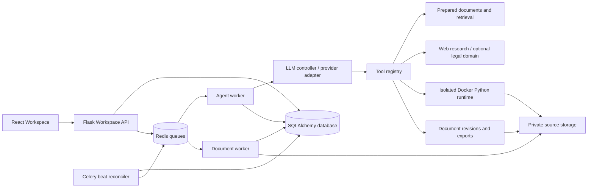

# Workspace architecture

The application remains one modular Flask service plus Celery workers. Redis carries jobs/results; SQL is the authoritative run and document store.

## Code map

- `backend/app.py`: Flask/local-auth/Celery factories and route registration.
- `backend/auth.py`: independent local accounts, hashed passwords, signed HttpOnly sessions and CSRF validation.
- `scripts/dev.py`: project-owned process lifecycle, ports and environment; never stops another project.
- `backend/config.py`, `backend/constants.py`, `config/dev-monica.json`: the local application environment.
- `backend/workspace/routes.py`, `backend/workspace_runs.py`: owned project/conversation/document APIs and saved run actions/artifacts.
- `backend/agent_tasks.py`: initialize, choose an operation, execute one saved operation, pause for clarification, and publish.
- `backend/workspace/execution.py`, `backend/util/workspace_service.py`: leases, recovery, freshness, cancellation and retries.
- `backend/ai/agent_tools.py`: validated tool arguments and execution against accepted source/artifact scope.
- `backend/ai/providers/`: provider contract and current decision adapter. `backend/ai/base.py` retains the current transport and structured helper calls.
- `backend/workspace/state.py`, `backend/util/workspace_store.py`: auxiliary state and canonical document/conversation persistence.
- `backend/document_preparation_tasks.py`, `backend/util/attachment_parser.py`, `backend/util/prepared_retrieval.py`: durable source preparation and versioned retrieval.
- `backend/documents/revisions.py`, `backend/util/document_drafts.py`, `backend/util/document_exports.py`: uploaded-original revisions, Markdown authoring and export.
- `backend/domains/legal/`: optional legal tools, source readers, citation handling and court formatting.
- `backend/util/python_execution.py`, `backend/python_runtime/`: the existing container execution boundary.
- `frontend/src/workspace/`: chat-first shell, per-project navigation, project dialogs, conversation, composer, optional inspector, and saved-result views.
- `frontend/src/upload/`: source preparation, transport, admission limits, and prompt-scoped exclusions.
- `backend/workspace/project_access.py`: shared project write lock for deletion versus new work/admission/retries.

## Request lifecycle

The API authorizes conversation ownership, captures an immutable prepared-source snapshot, and saves a `WorkspaceRun` before publishing a job. A worker conditionally claims that run with a lease. The model chooses a tool; its decision is stored. A subsequent worker executes that saved operation, rechecking ownership and cancellation before provider calls and writes. There is no fixed retrieve/draft/verify sequence and no Celery chain/chord orchestration.

Clarification saves the question and releases execution until the user answers. Completion atomically saves an optional selected document candidate and the durable conversation turn. Explicit retry resumes saved history; cancellation invalidates the worker lease so late results cannot publish. Beat recovers jobs whose SQL dispatch remains pending.

Source preparations have their own independent checkpointed workers and queue. Those continuations are ingestion infrastructure, not the removed version-0 agent pipeline.

The sidebar and inspector hold only presentation state in per-tab session storage. Folder selection during project naming does not establish a filesystem connection. Project deletion refuses active runs or preparations and serializes with admission using a short project write lock. See [frontend behavior and validation](frontend-redesign.md).
